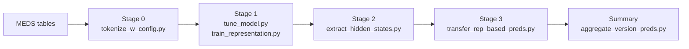

<div align="center">

# fms-ehrs

**Tokenize electronic health records, train generative medical event models, and probe what they learn.**

[](pyproject.toml)
[](LICENSE.md)
[](https://github.com/bbj-lab/input-representation-benchmark)
[](#citation)

[Overview](#overview) · [Installation](#installation) · [Pipeline](#pipeline) · [Representation options](#representation-options) · [Testing](#testing) · [Citation](#citation)

</div>

---

## Overview

`fms-ehrs` is the modeling library behind the benchmark
[**Representation Before Training**](https://github.com/bbj-lab/input-representation-benchmark)
(ML4H 2026). It converts MEDS event tables into token timelines and trains causal decoders on them. It then extracts frozen hidden states and fits linear probes on those states.

The companion repository [`input-representation-benchmark`](https://github.com/bbj-lab/input-representation-benchmark) schedules the 156 training runs, builds the outcome labels, and computes the statistics in the paper. This repository holds the model code.

## Installation

The two repositories share one Conda environment. Clone them next to each other, together with [Cocoa](https://github.com/bbj-lab/cocoa) for the Experiment 3 CLIF collation step.

```bash
git clone https://github.com/bbj-lab/input-representation-benchmark.git
git clone -b dev-input-rep https://github.com/bbj-lab/fms-ehrs.git
git clone https://github.com/bbj-lab/cocoa.git
git -C cocoa checkout 03f3f33f6e2ae8d2df2593966cc50bd500e57696

cd input-representation-benchmark
conda env create -f environment.yml   # installs cocoa, fms-ehrs, and the benchmark in editable mode
conda activate input-rep
```

To install only this library, use `pip install -e .` (add `".[clif-cocoa]"` for the Cocoa adapter). The library needs Python 3.12 or later.

## Pipeline



| Stage | Script | What it does |
| :-- | :-- | :-- |
| 0 (Exp. 3) | `collate_clif_with_cocoa.py` | Collates CLIF 2.1.0 tables with Cocoa and applies the frozen native-MIMIC patient split |
| 0 | `tokenize_w_config.py` | Writes token timelines, the vocabulary, and training-split numeric statistics |
| 1 (Exp. 1) | `tune_model.py` | Trains packed causal decoders across quantization and fusion settings |
| 1 (Exp. 2–3) | `train_representation.py` | Trains windowed causal decoders with numeric and temporal wrappers |
| 2 | `extract_hidden_states.py` | Extracts the final-layer state at the last valid token of the 24-hour input |
| 3 | `transfer_rep_based_preds.py` | Fits fixed logistic (`C = 0.01`) and Ridge (`alpha = 100`) probes |
| Summary | `aggregate_version_preds.py` | Collects probe predictions across outcomes and runs |
| Analysis | `eval_token_ce.py` | Computes token-level cross-entropy on held-out sequences |

All scripts live in [`fms_ehrs/scripts/`](fms_ehrs/scripts/).

## Representation options

The benchmark varies how numeric values and elapsed time enter the model. The wrapper in [`fms_ehrs/framework/model_wrapper.py`](fms_ehrs/framework/model_wrapper.py) implements each option.

| Axis | Option | Encoding |
| :-- | :-- | :-- |
| Numeric | `discrete` | One learned embedding for each quantile bin |
| | `soft` | Interpolation between the two adjacent bin embeddings |
| | `xval` | Shared `[NUM]` embedding scaled by the code-normalized value |
| | `xval_affine` | `xval` plus a learned bias vector |
| Temporal | `time_tokens` | Explicit time-interval tokens between events |
| | `event_order` | Unit-step position identifiers, no time tokens |
| | `time_rope` | Rotary position embeddings keyed to time since admission |

Quantization granularity (deciles to centiles), reference-range anchoring, and code–value fusion are tokenizer options in Stage 0.

## Tokenizer configurations

| Config | Use |
| :-- | :-- |
| [`mimic-meds-ed.yaml`](fms_ehrs/config/mimic-meds-ed.yaml) | Stage 0 tokenizer for Experiments 1 and 2 |
| [`mimic-meds-exp3-full.yaml`](fms_ehrs/config/mimic-meds-exp3-full.yaml) | Shared Stage 0 tokenizer for the native-MIMIC and CLIF arms of Experiment 3 |
| [`cocoa-exp3-clif-full.yaml`](fms_ehrs/config/cocoa-exp3-clif-full.yaml) | Cocoa collation policy for the Experiment 3 CLIF arm |
| [`mimic-meds.yaml`](fms_ehrs/config/mimic-meds.yaml) | Base MIMIC-IV MEDS tokenizer and the value that `tokenize_w_config.py` uses when you give no config |

## Stage outputs

| File | Written by | Read by |
| :-- | :-- | :-- |
| `<data_version>-tokenized/train/vocab.gzip` | Stage 0 | Stages 1–2 |
| `<data_version>-tokenized/train/numeric_stats.json` | Stage 0 | `xval`, `xval_affine` |
| `<data_version>_first_24h-tokenized/<split>/tokens_timelines.parquet` | Stage 0 | Stage 2 |
| `<model_dir>/checkpoint-*` | Stage 1 | Stage 2 |
| `<model_dir>/representation_mechanics.pt` | `train_representation.py` | Stage 2 wrapper rebuild |
| `<split>/features-<model_stem>.npy` | Stage 2 | Stage 3 |
| `test/*-preds-*.pkl` | Stage 3 | Summary and benchmark statistics |

The benchmark repository writes the outcome tables that Stage 3 reads.

## Repository layout

```text
fms-ehrs/
├── fms_ehrs/
│   ├── config/       Stage 0 tokenizer and collation configs
│   ├── framework/    tokenizer, datasets, model wrappers, temporal and value encoders
│   ├── scripts/      command-line entry points for Stages 0–3
│   └── tests/        unit tests and dry-run contract checks
└── notes/            guide for new event streams and outcomes
```

## Testing

```bash
pytest fms_ehrs/tests/unit
bash fms_ehrs/tests/dryrun/run_all.sh
```

The unit tests cover tokenizer determinism, value encoders, soft-target loss, xVal, temporal encodings, windowed datasets, CLIF collation, and prediction aggregation. The dry-run suite checks that each script in `fms_ehrs/scripts/` has a matching wrapper. See [`fms_ehrs/tests/README.md`](fms_ehrs/tests/README.md).

## Citation

If you use this code, please cite the benchmark paper:

```bibtex
@inproceedings{lee2026representation,
  title     = {Representation Before Training: A Practical Benchmark for Generative Medical Event Model Tokenization},
  author    = {Lee, Inhyeok and Solo, Luke and Burkhart, Michael C. and Ramadan, Bashar and Sethi, Sahil and Jabbour, Sarah and Parker, William F. and Beaulieu-Jones, Brett K.},
  booktitle = {Machine Learning for Health (ML4H) 2026},
  series    = {Proceedings of Machine Learning Research},
  volume    = {346},
  year      = {2026}
}
```

`fms-ehrs` builds on earlier work from the same group:

- M. Burkhart, B. Ramadan, Z. Liao, K. Chhikara, J. Rojas, W. Parker, and B. Beaulieu-Jones. Foundation models for electronic health records: representation dynamics and transferability. [arXiv:2504.10422](https://doi.org/10.48550/arXiv.2504.10422).
- M. Burkhart, B. Ramadan, L. Solo, W. Parker, and B. Beaulieu-Jones. [Quantifying surprise in clinical care: Detecting highly informative events in electronic health records with foundation models](https://doi.org/10.1142/9789819824755_0013). Pacific Symposium on Biocomputing 31 (2026), 173–188.

## License

Released under the [MIT License](LICENSE.md).
